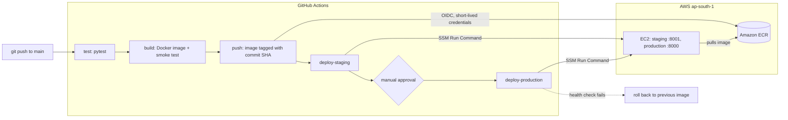
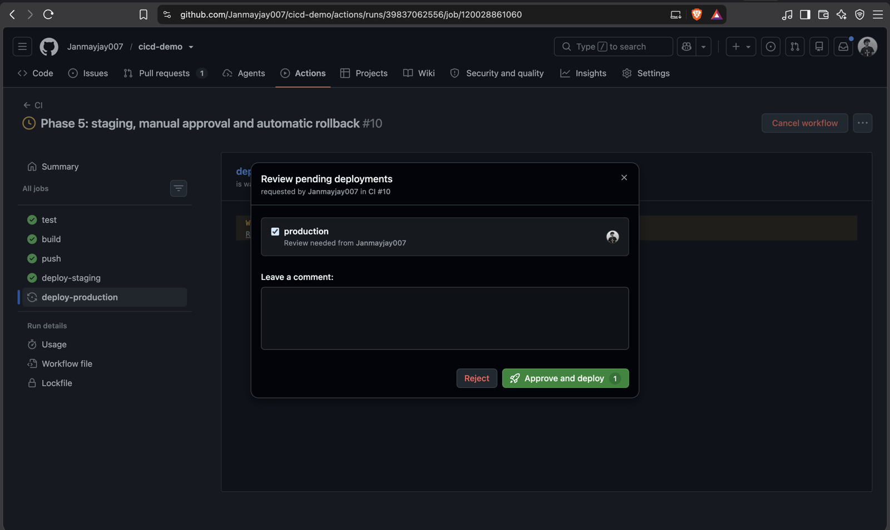
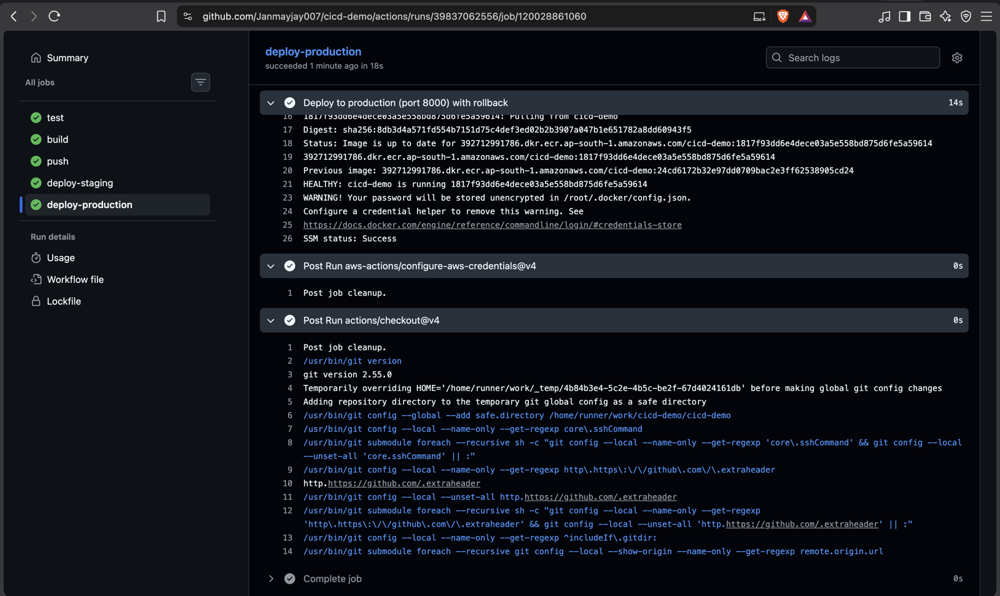
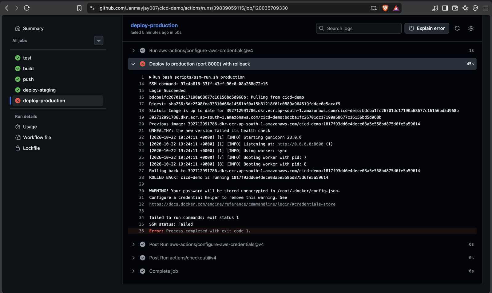
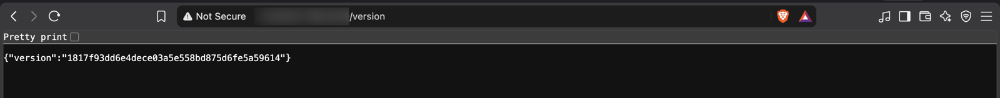
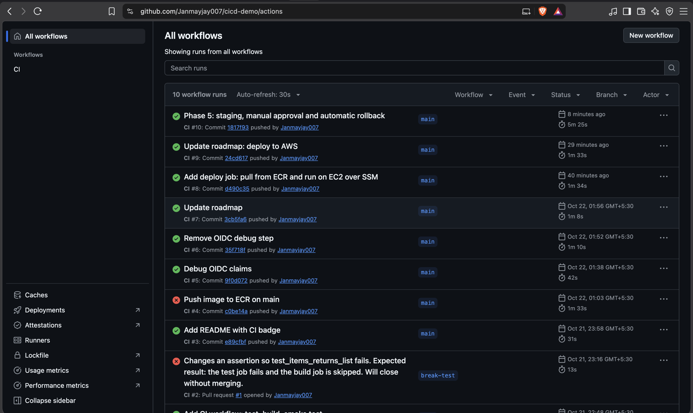
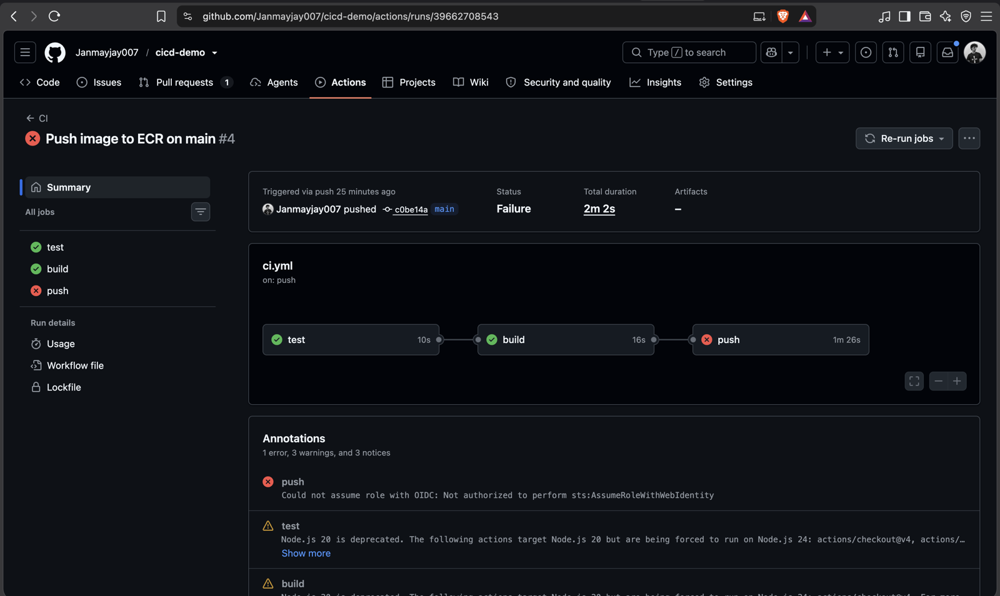

# cicd-demo


A small Flask API used to build a complete CI/CD pipeline on AWS. A push to `main` runs the tests, builds and smoke-tests a Docker image, publishes it to Amazon ECR, deploys it to a staging container, waits for a manual approval, then deploys to production on EC2. If production fails its health check, the pipeline puts the previous image back automatically.

GitHub Actions signs in to AWS with OIDC, so no AWS keys are stored anywhere, and deployments run through AWS Systems Manager, so the server has no open SSH port.

## Architecture



## The pipeline

1. **test**: installs dependencies and runs pytest. A failing test stops everything after it.
2. **build**: builds the Docker image, starts it, and fails unless `/health` answers.
3. **push**: signs in to AWS through OIDC and pushes the image to ECR, tagged with the commit SHA. Tags are immutable, so a tag always means exactly one build.
4. **deploy-staging**: runs the new image as a staging container on port 8001 and checks its health.
5. **Manual approval**: the `production` environment pauses the run until a reviewer approves.
6. **deploy-production**: records the image that is running, replaces the production container on port 8000, and checks `/health`. If the new version is unhealthy, it starts the recorded image again and fails the job, so a bad release is never mistaken for a good one.

The deploy logic lives in [`scripts/deploy.sh`](scripts/deploy.sh) (runs on the server) and [`scripts/ssm-run.sh`](scripts/ssm-run.sh) (sends it there over SSM).

## Screenshots

**Production waits for a human**



**A good release: the previous image is recorded, then the new one passes its health check**



**A deliberately bad release is rolled back**

The new container answers 503 on `/health`, so the script restores the previous image (log lines 20 to 28) and fails the job.



**Users kept the good version the whole time**



**Run history, failures included**



## Design decisions

- **No stored AWS credentials.** GitHub gets short-lived credentials through OIDC. The IAM role trusts only this repository, on `main` and the `staging` and `production` environments.
- **Least privilege.** The GitHub role can push to one ECR repository and run commands on one EC2 instance. The server's role can only pull from ECR and talk to Systems Manager.
- **No SSH.** Deployments use SSM Run Command. The security group opens only port 8000, to one IP address.
- **Immutable, commit-tagged images.** Rolling back means starting an older commit's image. Nothing is rebuilt.
- **Health checks at three levels.** Docker's `HEALTHCHECK`, the smoke test in CI, and the post-deploy check in the deploy script.
- **Non-root container** running gunicorn rather than Flask's development server.

## What broke and how I fixed it

| Problem | How I found it | Fix |
|---|---|---|
| `curl localhost:5000` returned nothing | `curl -i` showed `Server: AirTunes`: macOS AirPlay owned the port | Moved the app to port 8000 |
| A different app answered on port 8000 | `lsof` showed two processes listening; `ps` and the working directory identified a forgotten dev server | Stopped the stale process |
| GitHub could not assume the AWS role (`Not authorized to perform sts:AssumeRoleWithWebIdentity`) | Added a temporary step that decoded the OIDC token and printed its claims. The `sub` claim now includes numeric owner and repository IDs | Updated the role's trust policy to match the real subject |
| `docker: command not found` on the EC2 instance | Opened a Session Manager shell on the server | The user-data script had not run, so I installed Docker and enabled it at boot |



## Run it locally

```bash
python3.12 -m venv venv
source venv/bin/activate
pip install -r requirements.txt
python -m pytest -v
python -m app.main        # http://localhost:8000
```

With Docker:

```bash
docker build -t cicd-demo:local .
docker run -d -p 8000:8000 -e APP_VERSION=local --name cicd-demo cicd-demo:local
curl localhost:8000/health
```

| Endpoint | Returns |
|---|---|
| `/health` | `{"status":"ok"}`, or 503 when `SIMULATE_FAILURE=1` |
| `/version` | The running commit (`APP_VERSION`) |
| `/items` | A sample list |

## Rehearse a bad release

A commit message containing `[simulate-failure]` makes the production container return 503 on `/health`. Staging still passes, then production rolls back and the job fails.

```bash
git commit --allow-empty -m "Rehearse a bad release [simulate-failure]"
git push
```

## Costs and clean-up

The EC2 instance is the only part that costs money while idle, so it is stopped when not in use, and the account has a budget alert. To remove everything: terminate the instance and delete its security group, the ECR repository, the two IAM roles and the GitHub OIDC provider.

## Roadmap

- [x] Flask API with tests
- [x] Dockerfile with health check
- [x] CI: test, build, smoke test
- [x] Push images to Amazon ECR
- [x] Deploy to AWS
- [x] Staging, manual approval, production
- [x] Automatic rollback on failed health check
- [x] Architecture diagram

## Possible next steps

- Define the AWS resources in Terraform
- An Application Load Balancer with HTTPS in front of the app
- Blue/green releases on ECS
- CloudWatch metrics and alerts
